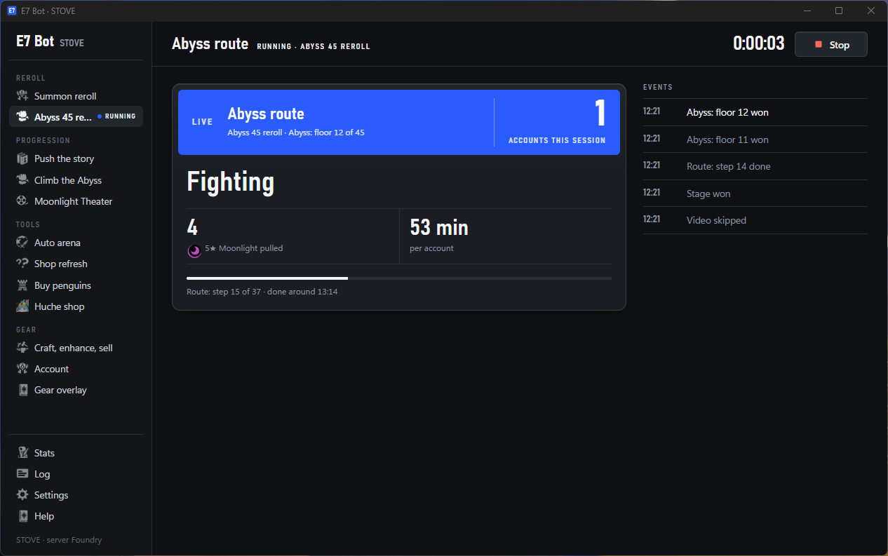
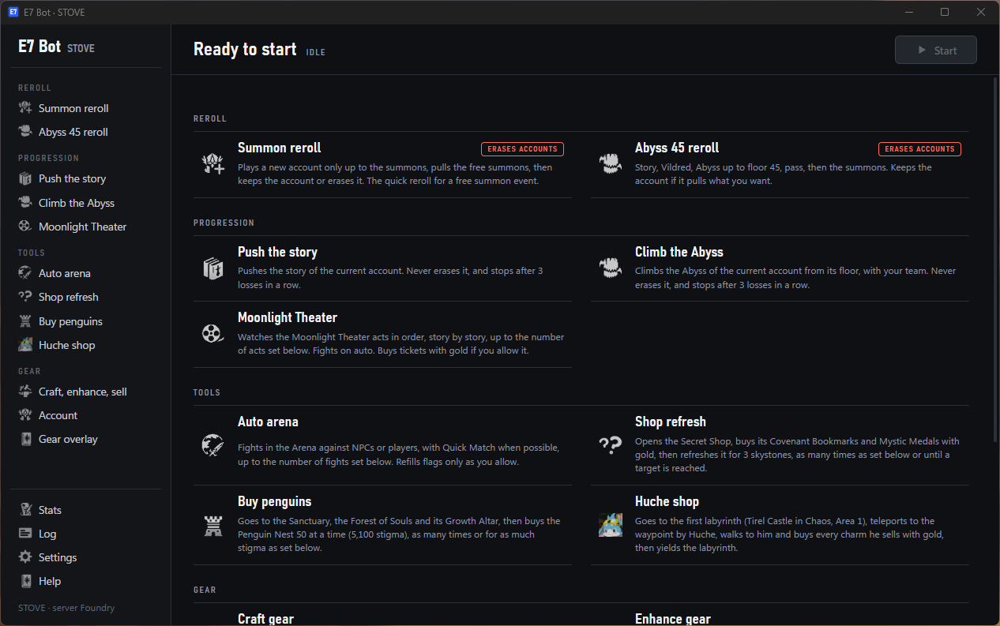

# E7 Bot

A bot for Epic Seven on the official PC clients, STOVE and Steam.

It started as a reroll bot: play a new account up to the free summons, pull, keep the account if it got a hero
you want, otherwise reset it and start again. It has more modes now: story, Abyss, Moonlight Theater, arena,
shops, and gear.

It only looks at the game window and sends clicks and key presses, like a person would. It doesn't read the
game's memory, doesn't touch its network traffic and doesn't modify any game file.



**[Download it here](https://github.com/Nabil080/e7bot/releases/latest)**, or run it from source (see below).

> [!WARNING]
> This is an unofficial program in the sense of Smilegate's Operation Policy (articles 6.1.4 and 6.1.7), and
> the penalty for using one goes up to a permanent ban. Enforcement is at their discretion and nothing here makes
> an account safe. Only use it on accounts you are ready to lose.

## Modes

| Mode | Does |
| --- | --- |
| Summon reroll | Plays a new account up to the summons, pulls the free ones, then keeps the account or resets it. |
| Abyss 45 reroll | The long reroll: story, Arbiter Vildred, Abyss up to floor 45, the pass, then all the summons. |
| Push the story | Carries on with the story of the current account, stops after 3 losses in a row. |
| Climb the Abyss | Climbs from the current floor with your team, stops after 3 losses in a row. |
| Moonlight Theater | Watches the acts in order, buys tickets with gold if you allow it. |
| Auto arena | NPC Challenge or players, Quick Match when there is one, flag refills only if you allow them. |
| Shop refresh | Buys the Covenant Bookmarks and Mystic Medals of the Secret Shop, then refreshes it. |
| Buy penguins | Buys the Penguin Nest in the Forest of Souls, 50 at a time. |
| Huche shop | Goes to Huche in the first labyrinth and buys every charm he sells. |
| Craft, enhance, sell | Crafts gear at the Steel Workshop, enhances the promising pieces, extracts or sells the bad ones. |
| Account | Reads every +15 piece and tells what your gear is worth, per role and per slot. |
| Gear overlay | You play, it never clicks: it reads the pieces on screen and tags each card with what to do with it. |

Only the two reroll modes ever erase an account: they reset each account that didn't pull what you want, on the
server set in **Settings > Reroll** (you can turn the reset off there). Every mode has its settings under
**This run**, and the **Help** page has a few steps for each one.



## How it works

There's no fixed script. Every tick, the bot takes a picture of the game, works out which screen it is and does
one action for that screen. If the game throws an unexpected popup or changes the order of its screens, the bot
follows, as long as it knows the screens.

- **Templates**: small crops of real screens (a button, a title) in `templates/`, listed in
  `templates/manifest.yaml`. OpenCV looks for them in the picture.
- **OCR**: Tesseract reads the text that matters: stage numbers, nicknames, servers, prices, gear stats.
- **Coordinates**: the bot sizes the game's client area to 1280x720 and checks it on every frame, so every
  position in the code is in that space, wherever the window is.
- **In the background**: the game is captured with `PrintWindow` and gets its clicks through `PostMessage`. You
  can keep using the PC, and the game can sit behind other windows. Don't minimize it, and don't click in it while
  the bot runs.
- **Input**: every action has a random delay and the clicks a few pixels of jitter (`input` in `config.yaml`).

### The reroll

Two rules decide whether an account is kept, and either one is enough: at least N 5-star Moonlight heroes, or one
of the heroes you picked in a list (`data/moonlight_heroes.json`). A 5-star artifact alone never keeps an account.

Resetting erases the account on that server for good, so the bot is careful about it. It stops instead of clicking
if the dialog title mentions Delete, if the server shown isn't the one in the settings, or if the last dialog
doesn't say what it expects. To reset, the game asks for the account's nickname: OCR sometimes mixes up `o`/`0` or
`l`/`1`, so if Confirm stays greyed out the bot cancels and tries the next likely spelling.

It never resets an account after something went wrong during the summons (it stops, the hero you want may be
there), and it stops when the game offers a patch, since the screens may have changed.

### Gear

Pieces are judged by role (damage dealer, bruiser, support, debuffer, tank...): each substat counts for what it
brings to that role, and the **efficiency** says how close a piece can get to a perfect one. The rules started from
a crafting guide for new accounts, and every threshold is in **Settings > Gear**. Try **Dry run** first, it judges
and logs every piece without touching any.

## Download

Get `E7Bot-<version>.zip` from the [latest release](https://github.com/Nabil080/e7bot/releases/latest). It holds
`E7Bot.exe` with everything it needs, Tesseract included: no Python, nothing to install.

1. Unzip it anywhere except Program Files.
2. Set the game to English (Settings > Language): the bot reads English screens.
3. Start the game, log in, and leave its window open, not minimized.
4. Run `E7Bot.exe`. On the first launch it asks which client to drive. With STOVE it asks for administrator
   rights too, because the STOVE client runs the game as administrator.
5. In **Settings > Reroll**, pick your server and what makes an account worth keeping. Then pick a mode on the
   left and press **Start**. **Stop** stops it at once.

The window uses Microsoft Edge WebView2, already there on Windows 11. Windows Defender or SmartScreen may flag
`E7Bot.exe`: it's a common false positive with packaged, unsigned Python programs.

To run STOVE and Steam side by side, use two copies of the folder: each copy keeps its own settings and stats.

What it writes in its folder:

- `settings.json`: what you set in the window
- `state_<client>.json`: stats and where the long reroll is, so a restart carries on
- `logs/bot.log`: every screen, click and decision
- `logs/results/`: a picture of each summon result
- `logs/failures/`: the screen each time the bot got stuck

## Running from source

You need Windows 10 or 11, and:

- [Python 3.11](https://www.python.org/downloads/)
- [Tesseract OCR](https://github.com/UB-Mannheim/tesseract/wiki), installed in `C:\Program Files\Tesseract-OCR`
  (or change `tesseract_cmd` in `config.yaml`)

```
git clone https://github.com/Nabil080/e7bot.git
cd e7bot
py -3.11 -m venv .venv
.venv\Scripts\python.exe -m pip install -r requirements.txt
.venv\Scripts\python.exe main.py
```

or double-click `run.bat`, which starts it without a console.

| Option | Does |
| --- | --- |
| `--client stove` / `steam` | the client to drive, instead of the one picked in the window |
| `--goal <name>` | the mode: `summons`, `abyss`, `story`, `climb`, `theater`, `arena`, `shop`, `penguins`, `huche`, `gear_*` |
| `--start reroll` / `continue` | start right away: reset the account first, or carry on with it |
| `--headless` | no window, just the bot and its log |
| `--probe` | find the game window, size it and print where it is |
| `--dry-run` | log what it would do without sending any input |
| `--once` | stop after one account |
| `--debug-overlay` | show the capture with what the bot sees |

### Building the release

```
.venv\Scripts\python.exe tools\package.py
```

builds `dist\E7Bot-<version>.zip` with PyInstaller: `E7Bot.exe`, its data and a copy of Tesseract. It never
includes your settings, state or logs. Pushing a tag such as `v1.0.1` makes the GitHub workflow build it and
publish it as the release "E7Bot 1.0.1".

## Tests

```
.venv\Scripts\python.exe -m pytest
```

About a thousand tests, most of them on real screenshots of the game in `tests/fixtures/`. Nicknames and account
numbers in those screenshots are pixelated.

When the game shows a screen the bot doesn't know:

1. Record it: `tools/record_session.py` saves a session played by hand, `tools/capture_template.py` saves the
   screen or a crop of it.
2. Cut a template from something that doesn't move (text, a button), put it in `templates/` and add it to
   `templates/manifest.yaml`.
3. Handle the screen in the right state under `states/`, before the screens it can cover.
4. Add the screenshot to `tests/fixtures/` with a test.

`tools/ui_preview.py` opens the real window with a pretend bot, to work on the interface without the game.

## Layout

- `main.py`: starts the window, or the bot alone with `--headless`
- `core/`: the game window, capture, input, template matching and OCR, the state machine, the gear rules, and
  `panel.py`, which is the logic behind the window
- `states/`: one file per state or mode (story, summon, reset, route for the long reroll, arena, gear...)
- `ui/`: the window's page, plain HTML, CSS and JavaScript shown by pywebview
- `templates/`: what the bot looks for on screen
- `tools/`: packaging and the tools above

The screenshots of the window come from `tools/ui_preview.py`: it's the real window, but the run and the numbers
are made up. Epic Seven, its art and its icons belong to Smilegate.
